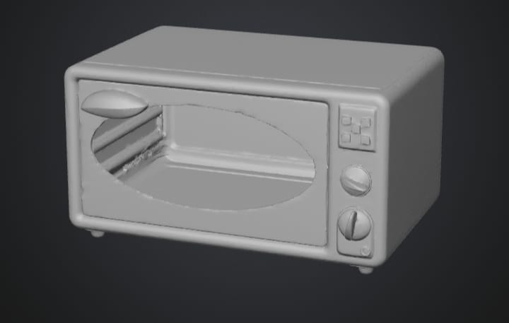
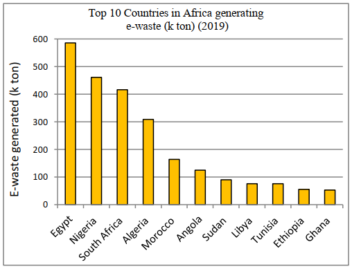
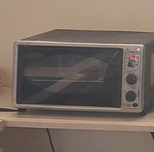
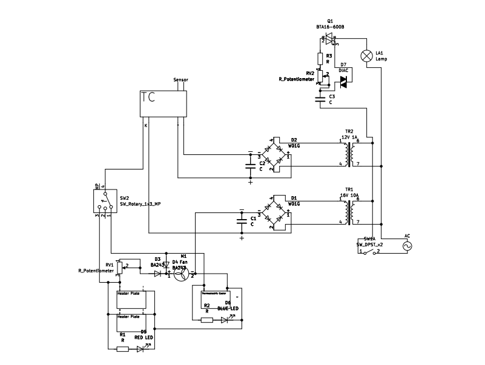
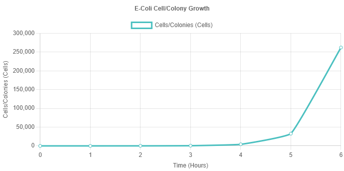

<h1 align="center">MultiCubator</h1>

<b>3D render of the incubator. The shell is an old oven.</b>

--------------------------
---------------------------------
### A dry-heat bacteriological incubator for school labs built from electronic waste: an old oven as the insulated shell, PTC heater plates, a Peltier TEC cooler, a salvaged home AC thermostat and a dimmer circuit for light control. Built as a capstone project for STEM High School for Boys - 6th of October.

### 
[Main Features](#main-features) **-** [The Capstone](#the-capstone) **-** [Problem](#the-problem) **-** [Design Requirements](#design-requirements--limitations) **-** [Prototype](#the-prototype) **-** [Testing](#testing) **-** [Conclusion](#conclusion) **-** [Recommendations](#recommendations) **-** [Files](#whats-where)

--------------------------

## Main Features

- Heats and cools. PTC heater plates and a TEC Peltier cooler hold the chamber between 27 and 45 °C under average usage, and beyond that range if needed.
- A thermostat salvaged from a home AC unit runs the control, switching the heater and cooler through its relay to hold the set temperature.
- A hand-soldered dimmer circuit (triac, diac, potentiometer) controls the light intensity inside the chamber.
- Every part is extracted from electronic waste: an old oven, a mini fridge, a PC power supply, a home AC unit and an old radio. **[All materials had to come from electronic & electric waste this semester]**.
- Proven on live bacteria: an E. coli sample grew from 1 cell to about 262,144 cells per colony in 6 hours inside it.
- Also works as a dough fermenter, an egg incubator and a simple cooler.

------------------------------------
------------------------------------

## The Capstone

The capstone is the biggest thing students do at STEM High School for Boys - 6th of October. A real problem, a working prototype for it, tests, and every step documented following the Engineering Design Process (EDP). Every term has its own design requirements and limitations that the design has to fit.

It is a team project, though I handled the majority of the prototype work here, as I have on every capstone project.

It runs through grades 10 and 11. On its own it is **60%** of the degree, and with its slice in every subject it is effectively around **80%** of the grades.

It has five parts:

- **Portfolio:** 60 to 80 pages in four chapters. Grand challenges, problem to be solved, prior solutions, selection of the solution, selection of the prototype, test plan, results, analysis, real-life recommendations and real-life location.
- **Poster:** Introduction, abstract, materials, methods, analysis, test plan, conclusion, real-life recommendations, citations and acknowledgements to everyone who helped.
- **Prototype:** The physical build, tested against the test plan.
- **Journals:** Every two weeks. Questions on personal reflection and the EDP process plus two connections between the project and the subjects taken. Other schools grade them anonymously on a red, yellow, green & blue scale and they are a key factor in the degree. Scores depend on the reviewers and vary significantly.
- **Logbook:** A weekly record of the work.

**This repository holds the project files only. The portfolio, the poster, the logbook, research sources and the hardware design.**

------------------------------------

## The Problem

Egypt generated about 690,000 tons of electronic waste in 2022, up 17.76% from 2019, and only around 2 to 3% of it is formally collected. Most of the rest ends up in uncontrolled landfills or with informal recyclers, while Egyptian schools and universities lack basic laboratory equipment. The selected problem: increase the capabilities of research in Egypt's laboratories through recycling electronic waste.

<b>Egypt is Africa's top e-waste generator (2019). Source: The Global E-waste Monitor 2020.</b>

Full write-up in [Problem To Be Solved](Portfolio/Problem/Problem%20To%20Be%20Solved.docx). Research sources in [Portfolio/Problem](Portfolio/Problem/).

------------------------------------

## Design Requirements & Limitations

- Build a scientific prototype instrument used in at least one type of laboratory, with an additional function compatible with its primary function.
- Multiple components sourced from old, used or discarded electrical devices, at least one of them electrical. **[This semester's limitation]**.
- Any sensor in the design must be calibrated using standard methods or instruments.
- The housing or cover must include a transparent material.
- Present the necessary voltage, the maximum current and the maximum operating power, plus a structural and electric circuit schematic.
- Results presented with graphical fitting methods using at least five readings, accuracy within ±5% of uncertainty.
- One real laboratory application demonstrated, since the instrument has multiple measurable functions.

------------------------------------

## The Prototype

- A compact dry-heat bacterial incubator for school labs, made for cultures that only need a stable temperature, like E. coli and Bacillus.
- The shell is an old oven. Its insulated chamber keeps the heat constant, with a recycled acrylic side window to watch the growth.
- Heating: two PTC aluminum heater plates mounted on a PC heatsink with a fan for even convection.
- Cooling: a TEC thermoelectric (Peltier) cooler on the back of the oven.
- Control: the home AC thermostat reads the chamber and drives the heater and cooler through its relay. Fan speeds are set with variable resistors.
- Power: two recycled transformers, 16V 10A for the heater & cooler and 12V 1A for the thermostat, with rectifier bridges and capacitors softening the DC.
- Outer dimensions 45 x 35 x 40 cm, inner chamber 32 x 22 x 30 cm.

<b>The finished MultiCubator, as shown in a school post.</b>

<b>The MultiCubator circuit schematic.</b>

Selection process in [Selection of Prototype](Portfolio/Selection%20of%20Prototype/Selection%20of%20Prototype.docx).

------------------------------------

## Testing

- Voltage at the PTC heaters and TEC cooler measured with a voltmeter: exactly 12V, matching the heaters.
- The thermostat was calibrated against a thermometer. It was off by 0.9 °C, then 0.4 °C, and was recalibrated until it matched.
- A digital thermometer on the frame measured no temperature change outside the chamber, confirming the insulation.
- An E. coli sample incubated for 6 hours at 37 °C showed exponential growth: 1 cell to 262,144±127 cells per colony, dividing about every 20 minutes.

<b>E. coli colony growth during the 6-hour test.</b>

Test plan and full results in [Test Plan and results](Poster/Test%20Plan%20and%20results.docx).

------------------------------------

## Conclusion

The prototype met the major design requirements: at least two functions (generating heat and controlling light intensity) and at least one measurement (the internal chamber's temperature). It also undercuts the two reviewed prior solutions, the VEVOR 20L lab incubator and the Thermo Scientific Heratherm IGS180, on initial price. Full conclusion in [Conclusions](Poster/Conclusions.docx).

------------------------------------

## Recommendations

- A humidity control system, to keep the agar from evaporating on longer runs.
- A CO2 injection system, for culture media that need it.
- Water jacket insulation instead of the passive foam.
- Stainless steel and copper lining, against cross-contamination.

Details in the [Portfolio](Portfolio/) and the [Humidity control system recommendation](Poster/Humidity%20control%20system%20recommendation.docx).

------------------------------------

## What's Where

- [Portfolio](Portfolio/) - the full portfolio PDF, the problem write-up with its research sources & the prototype selection
- [Poster](Poster/) - the A4 & full-size posters and every poster section as a separate document
- [Photos](Photos/) - the 3D render, a photo of the real device, circuit diagram, growth graph & component pictures
- [Hardware/KiCad/Project](Hardware/KiCad/Project/) - KiCad schematic & PCB project files and the schematic PDFs
- [Logbook](Logbook/) - the weekly logbook, DOCX & PDF

------------------------------------

## License

See [LICENSE](LICENSE).
